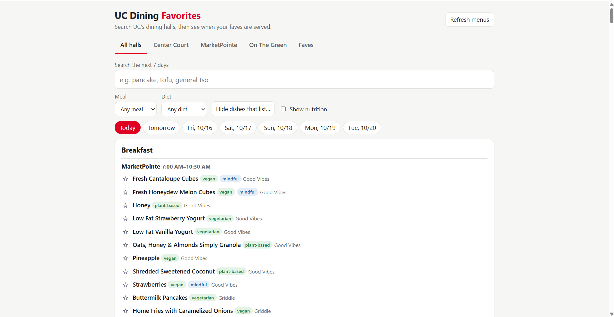
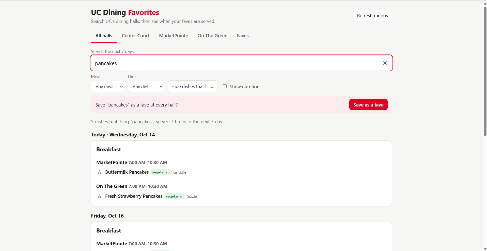
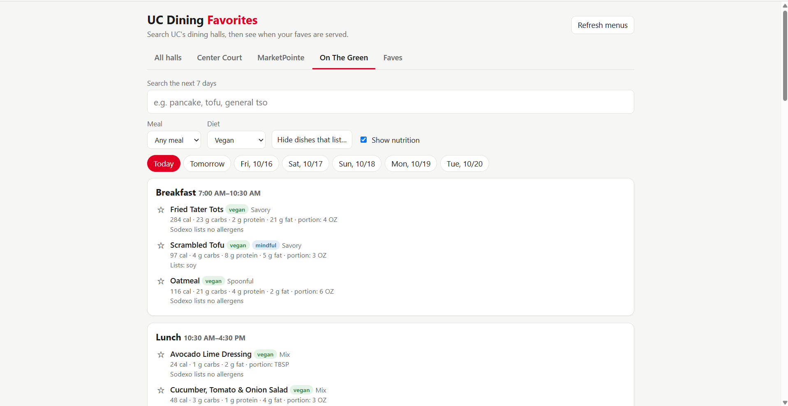
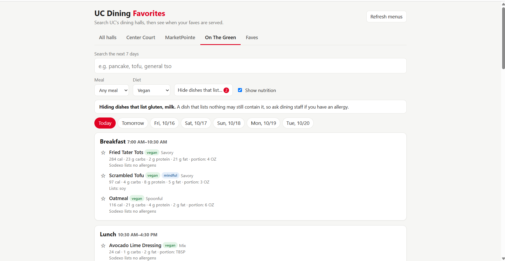
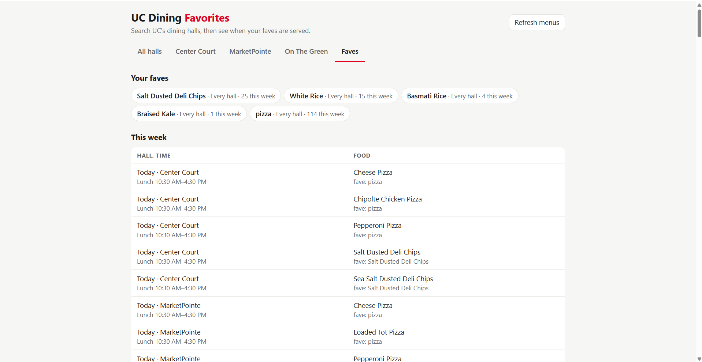
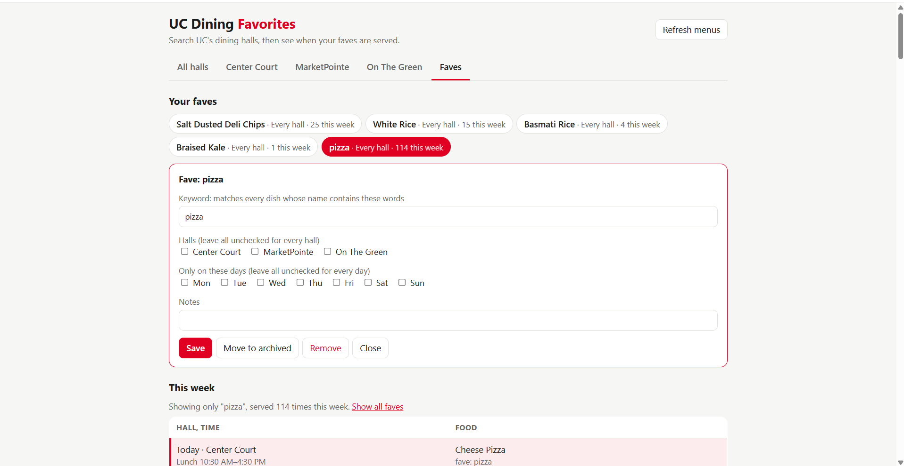
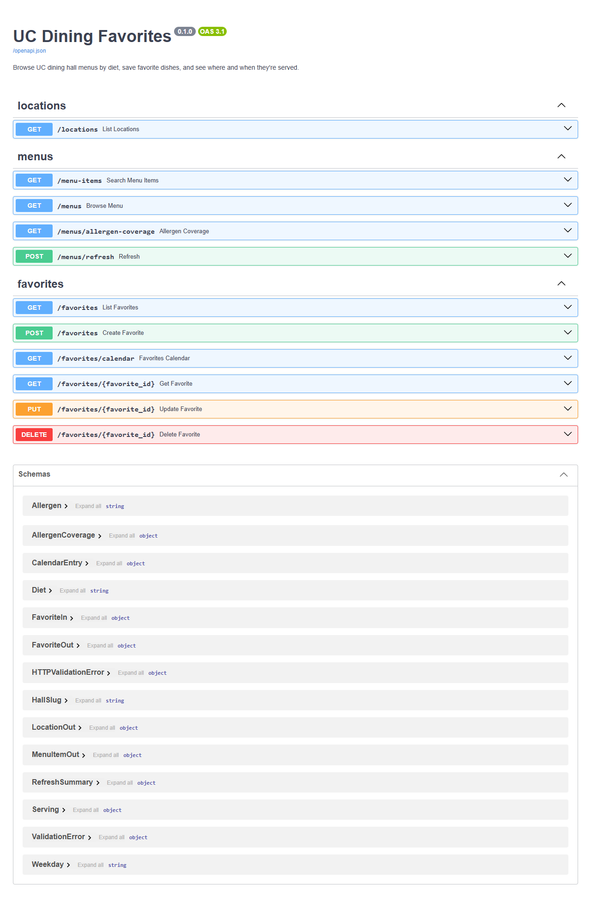

# UC Dining Favorites

Search what every University of Cincinnati dining hall (Center Court, MarketPointe, On The Green) is serving over the next week, filter by meal, diet and allergens, check nutrition, and save favorite dishes to see which hall serves them, on which day, and at what time.

- **Demo video (about 2½ minutes):** coming soon on YouTube <!-- TODO: replace with the unlisted YouTube link -->
- **How it was built, and how AI was used:** [docs/PROCESS.md](docs/PROCESS.md), the process write-up and AI reflection for CS4005 Project 1
- **Requirements, design, and every decision with its date:** [PROJECT_SPEC.md](PROJECT_SPEC.md)



It runs on your own computer, and you can download it from this repository (see [Run it](#run-it)).

## What it does

**Search first.** Type a dish, such as "pancake" or "tofu", to see everywhere and every time it's served in the next 7 days. One click saves the search as a fave.



**Browse one hall, or all of them.** Pick a day to see its menu grouped by meal, with each meal's hours. Filter by meal and by diet (vegetarian, vegan, plant-based, mindful). Nutrition (calories, carbs, protein, fat, portion size) stays hidden until you tick **Show nutrition**, so the page isn't cluttered.



**Allergen filters, stated honestly.** "Hide dishes that list…" hides dishes that *list* gluten, milk, or another allergen. Sodexo has no "gluten-free" label, so the page never claims one. If few dishes at a hall list allergens that day, it warns that the data looks incomplete.



**Faves.** See when everything you follow is served this week, as a table of hall and time against food. Click a fave or a row to see only that fave's rows, edit it, limit it to certain days ("only Saturdays"), move it to archived faves, or remove it.

| All your faves this week | One fave opened |
|---|---|
|  |  |

## How to use it

1. Open the app (see [Run it](#run-it)) and click **Refresh menus** if today's menu is missing.
2. Choose **All halls** to compare every hall, or a hall's tab to see just that hall.
3. **Search** for a dish, or pick a day and look through its meals. Narrow the list with **Meal**, **Diet**, and **Hide dishes that list…**, and tick **Show nutrition** when you want the numbers.
4. Save what you like: ☆ next to a dish saves that dish; **Save as a fave** saves a whole search, like "pancake".
5. Open **Faves** to see when they're served this week. Click one to edit it, limit it to certain days, archive it, or remove it.

## How it works

```
Sodexo menu API ──> app/ingest.py ──> uc_menu.db (SQLite) ──> FastAPI JSON API ──> web page
  (same data the      (downloads 7 days       (dishes, servings,        (app/main.py,         (app/static/
   UC Dining site      for 3 halls, 4 at       favorites)                app/routers/)         index.html)
   uses)               a time, retries once)
```

- **Menus** come from the same Sodexo API the UC Dining website uses: 7 days for 3 halls is 21 requests per refresh. Each dish is stored once, with its nutrition, diet labels, and listed allergens. Each serving records the hall, date, meal, and station.
- **Meal times** come from each hall's regular hours, because the menu API has none.
- **Matching:** a keyword matches a dish when every word in it appears in the dish name, so "pizza" finds every pizza. A fave is a keyword, optionally limited to certain halls and weekdays.
- **Allergen check:** for each hall and day, the app counts how many dishes list any allergen, and warns when fewer than 1 in 4 do.
- **Safety:** the app has no accounts, only answers requests addressed to your own computer, and keeps the menu API key in your own `.env` file.
- **Testing:** 80 automated tests run without internet, on trimmed copies of real menus. Every change to the page was also checked by driving the real app in a browser.
- **Built with AI:** Claude Code wrote the code from the author's requirements, interviews, and design decisions. The write-up is in [docs/PROCESS.md](docs/PROCESS.md).

The page is built on a JSON API, documented interactively at http://127.0.0.1:8000/docs while the app runs (see [API](#api)).



Menus come from Sodexo's API, which UC Dining's terms allow for personal, non-commercial use. The app names itself in each request and only downloads menus when you ask; `PROJECT_SPEC.md` section 10 has the details.

## Run it

**1. Install Python 3.11 or newer** from https://www.python.org/downloads/. On Windows, tick **"Add python.exe to PATH"** on the installer's first screen. If typing `python` in a terminal opens the Microsoft Store, Python isn't installed yet.

**2. Get the code.** With Git: `git clone https://github.com/Marcus-Hollimon/UC-Menu-Project.git`. Without Git: on the GitHub page, click **Code → Download ZIP** and unzip it.

**3. Get the menu API key** (see "Get the menu API key" below) and save it. Open a terminal in the project folder (the one containing `README.md`), run `copy .env.example .env` on Windows or `cp .env.example .env` on macOS/Linux, then open `.env` in a text editor and paste the key after `SODEXO_API_KEY=`. The key isn't included in this repository. `.env` is ignored by git, so it stays on your computer.

**4. In the same terminal, run:**

Windows (PowerShell):

```
python -m venv .venv
.venv\Scripts\python.exe -m pip install -r requirements.txt
.venv\Scripts\python.exe -m app.ingest
.venv\Scripts\python.exe -m uvicorn app.main:app
```

macOS / Linux:

```
python3 -m venv .venv
.venv/bin/python -m pip install -r requirements.txt
.venv/bin/python -m app.ingest
.venv/bin/python -m uvicorn app.main:app
```

**5. Open http://127.0.0.1:8000.** The app runs until you press Ctrl+C in the terminal. Next time, only the last command is needed.

The first three commands run once: create a private Python environment in `.venv`, install the libraries into it, and download the next 7 days of menus into a local SQLite file, `uc_menu.db`. If the key is missing, the download stops and says so. Menus change daily. Use the **Refresh menus** button on the page to fetch new ones. Sodexo posts menus only a few days ahead, so later days may be empty. If the download reports failures, Sodexo was slow to answer; refresh again later.

These commands call `.venv`'s Python directly instead of "activating" the environment, because Windows often blocks the activate script ("running scripts is disabled on this system").

**Keep it on your own computer.** The app has no accounts or passwords, so it only accepts connections from the computer it runs on. Don't start it with `--host 0.0.0.0` (for example, to open it on your phone), especially on campus Wi-Fi. Anyone on the same network could then read and change your favorites, or make your computer send repeated requests to Sodexo. As a backstop, the app refuses any request not addressed to `127.0.0.1` or `localhost` ("Invalid host header").

### Get the menu API key

The UC Dining website loads its menus from Sodexo's menu API, and your browser sends the API's key with every menu request it makes. This app uses the same key, for your own personal, non-commercial use.

1. In Chrome or Edge, open https://ucdining.sodexomyway.com/en-us/locations/on-the-green.
2. Press **F12** to open the developer tools, and choose the **Network** tab.
3. Reload the page (**F5**). In the Network tab's filter box, type `api-prd`.
4. Click the request whose name starts with `150721`, and look under **Headers → Request Headers** for **Api-Key**.
5. Copy that value into `.env` as `SODEXO_API_KEY=<the value>`.

If Sodexo ever changes the key, downloads start failing; repeat these steps to get the new one.

### Updating

When you pull a newer version, the app adds any new database columns by itself at startup and keeps your favorites; click **Refresh menus** afterwards to fill in new menu details. If it ever can't upgrade, it stops and says so. Then rebuild with `.venv\Scripts\python.exe -m app.ingest --reset` (macOS/Linux: `.venv/bin/python -m app.ingest --reset`), which also deletes your favorites.

## API

The page is built on a JSON API. Try every endpoint at http://127.0.0.1:8000/docs.

| Method | Path | What it does |
|---|---|---|
| GET | `/locations` | List the dining halls |
| GET | `/menu-items?q=pizza&hall=marketpointe&diet=vegetarian` | Search dishes by name |
| GET | `/menus?day=2026-10-08&hall=center-court&meal=Lunch&diet=vegan&exclude_allergen=GLUTEN` | One day's menu, with nutrition and listed allergens |
| GET | `/menus?q=pancake&days=7` | Where and when dishes matching a keyword are served |
| GET | `/menus/allergen-coverage?day=2026-10-08` | How many dishes per hall list any allergen, and whether that looks incomplete |
| POST | `/menus/refresh?days=7` | Download fresh menus from Sodexo |
| POST | `/favorites` | Add a favorite: `{"keyword": "pancake", "halls": [], "days": ["saturday"], "notes": ""}` |
| GET | `/favorites` | List favorites, active and archived |
| GET | `/favorites/{id}` | Get one favorite |
| PUT | `/favorites/{id}` | Replace a favorite's keyword, halls, days, notes and `archived` flag |
| DELETE | `/favorites/{id}` | Remove a favorite |
| GET | `/favorites/calendar?days=7` | Where and when your favorites are served (`&archived=true` for archived ones) |

A keyword matches a dish when every word in it appears in the dish name, ignoring case. `halls` limits matches to those halls, and `days` to those weekdays; empty lists mean all. `diet` is one of `vegetarian`, `vegan`, `plant-based`, `mindful`. `exclude_allergen` (repeatable) is one of `GLUTEN`, `WHEAT`, `MILK`, `EGGS`, `SO` (soy), `SESAME_SEEDS`, `FISH`, `TREE_NUTS`, `PEANUTS`, and hides dishes that **list** it.

## Tests

```
.venv\Scripts\python.exe -m pytest
```

(macOS/Linux: `.venv/bin/python -m pytest`.) Tests use an in-memory database and saved menus in `tests/fixtures/`, so they don't need the internet.

## Project layout

```
PROJECT_SPEC.md  requirements, design, decisions and status
docs/
  PROCESS.md       how it was built and how AI was used (CS4005 write-up)
  screenshots/     the screenshots in this README
  sketches/        the author's hand-drawn designs
app/
  main.py          FastAPI app; serves the page at /
  static/index.html  the web page (plain HTML, CSS and JavaScript)
  halls.py         hall IDs and meal hours
  sodexo.py        download menus and flatten the JSON
  ingest.py        load menus into the database (python -m app.ingest)
  database.py      database connection (SQLite by default)
  models.py        tables: locations, menu_items, schedules, user_favorites
  schemas.py       request/response shapes
  routers/         endpoints: locations, menus, favorites
tests/             pytest suite and fixture menus
```

## Known limitations

- Menus show what's planned. Dishes can run out or change.
- Diet labels, allergens and nutrition come straight from Sodexo, and are sometimes missing. "Hide dishes that list gluten" only hides dishes that *list* gluten; a dish listing nothing may still contain it. The page warns when a hall's allergen lists look incomplete, but don't rely on this app for an allergy; ask dining staff.
- Meal times are each hall's regular hours (copied from the UC Dining site on 2026-09-22). Breaks and holidays aren't handled.
- Matching is substring-based, so "ham" also matches "Graham Cracker".
- Only the three residential halls publish menus. Retail locations (Stadium View, Chick-fil-A, and others) don't, so they can't be included, even though students asked for them.
- Each copy of the app has its own favorites; they don't sync between computers.

## Optional: Postgres

The app can use Postgres instead of SQLite. In `.env`, remove the `# ` in front of `DATABASE_URL` and set it to a Postgres connection string. `.env` is git-ignored so the password never gets committed. This was set up for public hosting, which the project decided against (`PROJECT_SPEC.md` decision 1 and section 6.6).

## Credits

Built by [Marcus-Hollimon](https://github.com/Marcus-Hollimon) for CS4005, Project 1 (human-guided software development), with Claude Code writing the code. Not affiliated with the University of Cincinnati, UC Dining, or Sodexo.
