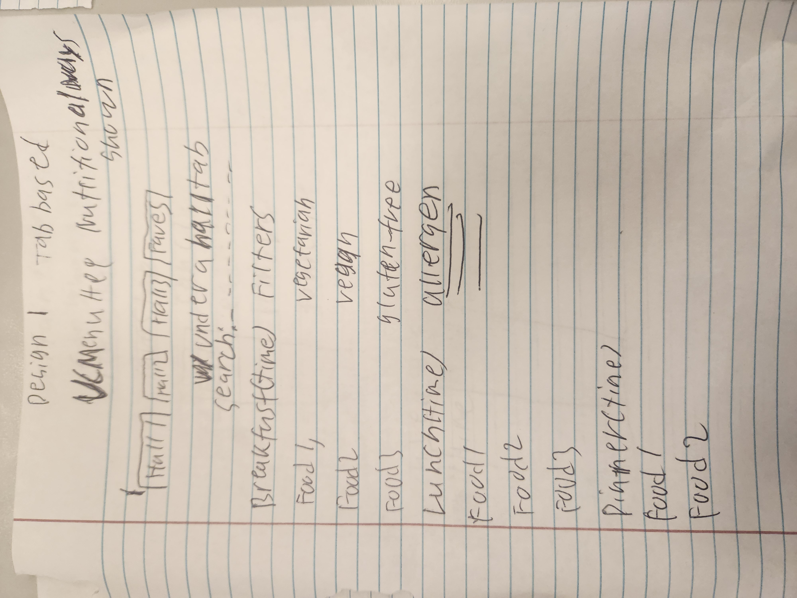
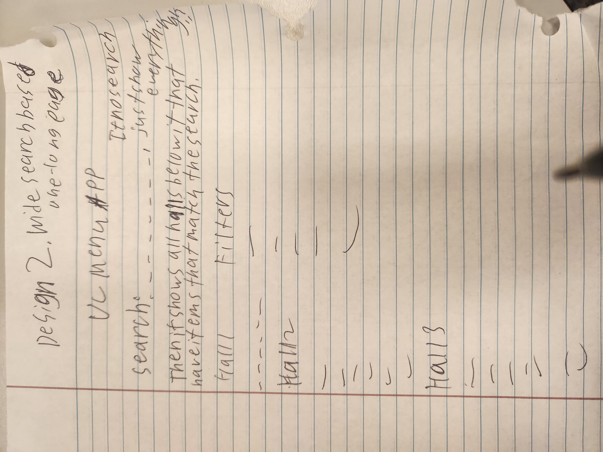
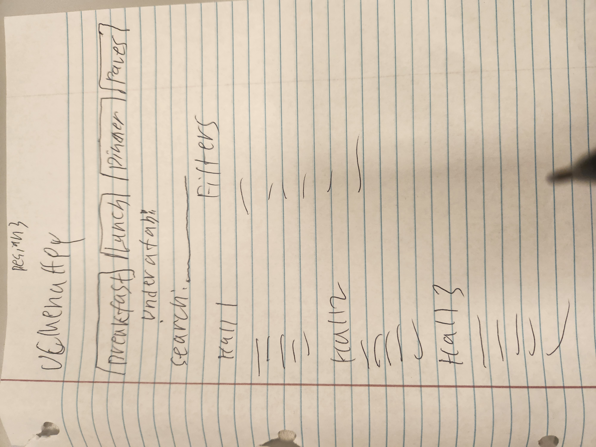
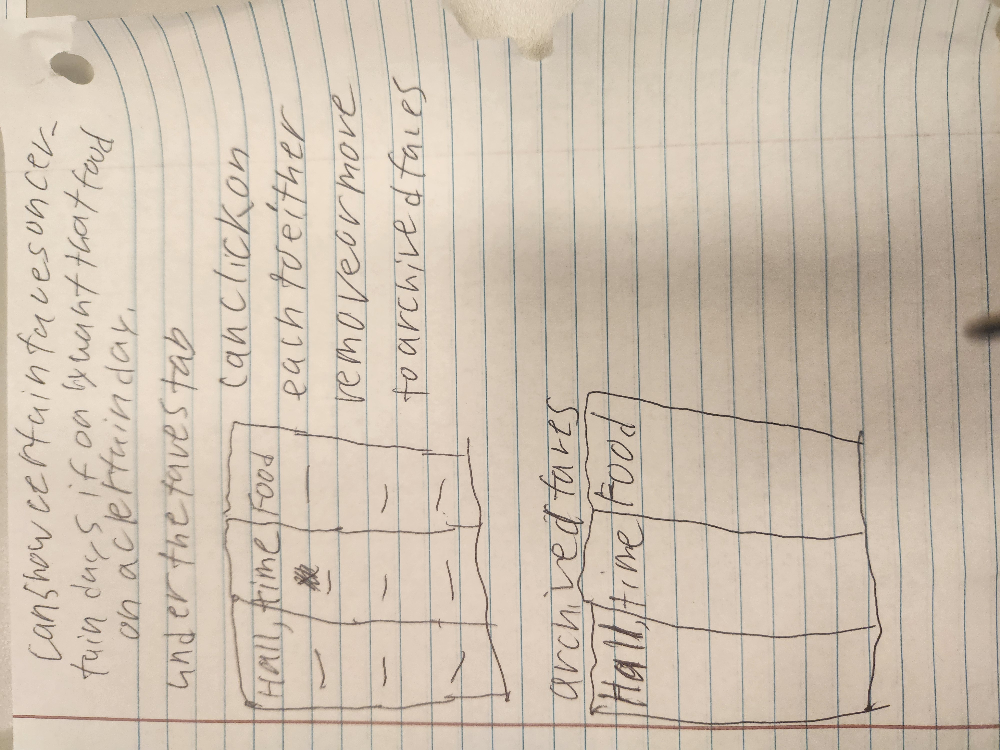
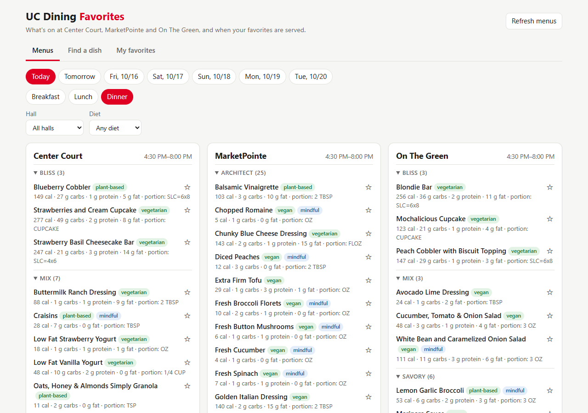

# How UC Dining Favorites was built: process and AI reflection

CS4005, Project 1: human-guided software development · [Marcus-Hollimon](https://github.com/Marcus-Hollimon) · September 22 – October 14, 2026

This is the process half of the project. The app is described in the [README](../README.md). The requirements, design, and every decision with its date are in [PROJECT_SPEC.md](../PROJECT_SPEC.md).

## In short

- **Problem:** UC students move between three dining halls, but finding out what each one is serving, and whether a dish they like is coming up this week, means opening each hall's menu page one at a time.
- **What I built:** a web app, run on your own computer, that searches all three halls' menus for the next 7 days. It filters by meal, diet, and listed allergens, shows nutrition when you want it, and tracks favorite dishes across halls.
- **How I used AI:** a web chat assistant for brainstorming, first requirements, and interview questions; then Claude Code (an AI agent inside VS Code) for research, the spec, all of the code, the tests, and git. My rule: the AI writes the code; I make the decisions.
- **Biggest lessons:**
  1. Mistakes were cheap because the AI ran the real app in a real browser, not just its tests.
  2. Asking the AI to argue against its own plan changed the project more than any other prompt.
  3. Talk to users before building.

## Tools

| Tool | Used for |
|---|---|
| Web chat assistant | Steps 1–2: checking the idea, first user stories and requirements, interview questions |
| Claude Code in VS Code | Steps 2b–4: research, the spec, all code, tests, driving the app in a browser, git |
| Google search and Google's AI | A second opinion on a legal question (Experiment 4) |

## Timeline

| Date | What happened |
|---|---|
| Sept 22 | Found the menu data source; built the backend, favorites CRUD, and 34 tests; turned my requirements into a spec; compared hosting options |
| Sept 24 | Devil's-advocate review of the plan; two interviews; dropped the calendar idea and made the app local-first; diet filter, nutrition, and the first web page; published on GitHub; tested a fresh download; security review; researched the data source's terms |
| Oct 8 | Drew my own designs; rebuilt the page from them; allergen filters; favorites with weekday limits and archiving; kept the data source's key out of the repository and its history |
| Oct 14 | Design feedback from an interviewee; this reflection |

---

## Step 1: Identify a problem

**What I did.** I came to this with a problem I had myself: not knowing what each dining hall was serving, or when a dish I liked would come up. My first version of the idea was to track UC's menus and put favorite dishes on your calendar.

**How AI helped.** I gave the web chat assistant my idea and the project directions. It judged whether the idea was buildable and drafted user stories and questions. Later, Claude Code raised things I hadn't considered, like whether the menu data could be used this way at all (see Step 2c).

**Risks and mitigation.** An AI evaluates the idea you bring it. It checked whether the calendar idea could be built, not whether anyone wanted it. The interviews (Step 2a) were the check on that.

**What worked / what didn't.** The quick feasibility check worked. The calendar assumption went unchallenged until the interviews.

**Notes.**
- **The calendar was dropped mainly on cost versus benefit.** Linking to Google Calendar would have needed a public server, accounts, and subscription feeds, while a student who finds a dish in the app can add it to their own calendar in seconds. The interviews backed that up.
- **Originality.** Sodexo's own app (Bite) also shows menus. This project didn't need to be original, and it does something Bite doesn't: it compares all three halls at once and tracks favorites across them.

## Step 2a: Interviews

**What I did.** I interviewed two students by text message. They're called Interviewee 1 and Interviewee 2 here. I never put their names into any AI prompt.

**The questions** (written with AI, as described below):

1. Walk me through everything you ate on campus yesterday, from when you woke up.
2. Is there anything on campus you actually look forward to eating? When did you last have it, and how did you know it'd be there?
3. Tell me about the last time you showed up and nothing looked good. What did you do?
4. Can you pull up your calendar and show me this week?
5. What should I have asked you about eating on campus that I didn't?

**What I learned:**

| What I heard | What changed |
|---|---|
| Neither uses a calendar for meals. One skipped the question; the other said "Idk what to put." | Calendar feature dropped |
| Interviewee 1 goes to a different hall when nothing looks good. Interviewee 2 ate at three halls in one day. | The app compares all the halls at once |
| Interviewee 2 eats plant-based at every meal. | Diet filter moved up |
| Interviewee 1 wanted to know "portion or carbs." | Nutrition added; the data source already had it |
| Interviewee 2 looks forward to plant-based pancakes but never knows when they'll be served. | Favorites kept; search covers the whole week |
| Interviewee 2 once found no tofu scramble, though the menu lists it every weekday. | Menus show what's planned; food running out can't be fixed with menu data |
| Both ate lunch at Stadium View, a retail spot. | Checked every UC Dining location: none besides the three halls publishes a menu |

**AI reflection:**
- **Useful: writing the questions.** The AI's questions followed the course's rules: ask about the person, and about past experiences rather than hypotheticals. They were also designed to *disprove* my idea; question 4 did exactly that for the calendar. I want pushback from an AI, not a yes-man.
- **Useful: analyzing the answers.** The AI brute-forced checks of the answers against the real menu data, which would have been tedious by hand: the tofu scramble was on the menu every weekday, and the plant-based pancakes turned up in a later search.
- **Not useful: running the interview.** Getting useful answers takes interviewing skill, like knowing when to follow up. Question 4 ("pull up your calendar and show me") was written for a face-to-face conversation, and by text it got short answers.
- **Risk: a small sample.** Two interviews, and one participant eats plant-based. The changes that came from that were filters, which cost little and help anyone.

## Step 2b: Needs, user stories, and requirements

**Five needs:**
1. **Predictability:** know ahead of time when specific favorite dishes are served, so you don't miss them.
2. **Aggregated visibility:** one view that compares what every hall is serving, without checking each hall's page.
3. **Diet and nutrition:** narrow menus to dishes that fit your diet, and see what a dish is (calories, carbs, protein, portion) before choosing.
4. **Schedule:** a day-by-day view of the coming week showing when favorites are served.
5. **Watchlist control:** edit and remove saved favorites so the list stays relevant as tastes change.

**Five user stories:**
1. **[Create]** As a dining hall regular, I want to save a dish to my favorites, so that I can see when it appears on the upcoming schedule.
2. **[Read]** As a busy student, I want a 7-day view of the days, halls, and meal times when my favorites are served, so that I can plan where to eat around my classes.
3. **[Read]** As an on-campus resident, I want to see one meal at every hall, filtered by my diet and showing nutrition, so that I can pick where to go and what to eat.
4. **[Update]** As a student with changing preferences, I want to edit a favorite's keyword, halls, days, and notes, or archive it, so that I only see schedules relevant to my routine.
5. **[Delete]** As a student, I want to remove a favorite, so that it stops appearing in my week view.

**Requirements** ("Application must…"). The full list, with acceptance criteria and status, is in [PROJECT_SPEC.md](../PROJECT_SPEC.md) section 4.

| ID | Application must… | CRUD |
|---|---|---|
| N1 | let a user create a watch entry for a named menu item at one or more locations | Create |
| N2 | display all upcoming occurrences of a user's watched items, with date, meal period, and location | Read |
| N3 | let a user edit an existing watch entry, including its locations and days | Update |
| N4 | let a user delete a watch entry and remove its upcoming occurrences | Delete |
| N5 | let a user view a day's menu, filtered by meal, diet, and listed allergens, with nutrition | Read |
| D1–D5 | retrieve 7 days of menus; match tolerantly; record nutrition, diet, and allergens; keep serving the last good data; cover every location that publishes a menu | |
| C1–C3 | (calendar subscription feed) **dropped after the interviews** | |

**AI reflection:**
- **Risk: requirements before evidence.** The AI drafted my first requirements, including a calendar feed and user accounts, from my idea, before any interview answers existed. After the interviews, the calendar requirements were dropped and accounts were never built. On a project this small that only cost some planning. On a large app, building features before learning whether anyone wants them could waste months. **Get interview answers first.**
- **Useful: expanding and organizing.** Requirement IDs, acceptance criteria, a status table, and a dated decisions table kept everything trackable through two redesigns.
- **Data-dependent requirements need room to change.** The allergen filter was dropped when only 6% of dishes listed allergens (Sept 22), and brought back when 50% did (Oct 8), with honest naming and a warning when a hall's data looks incomplete.
- **A spec is a record, not a rulebook.** The spec was most useful as a record of what was decided and why. It was freeing not to be attached to it: when something changed, we rewrote it.

## Step 2c: Research

**What was found:**
- **Data source.** Claude found that the UC Dining website loads its menus from Sodexo's menu API, which returns clean data per dish (nutrition, diet labels, allergens), so nothing had to be scraped from web pages. It also checked all 21 UC Dining location pages: only the three residential halls publish menus.
- **Tech stack:** Python with FastAPI, a SQLite database, and a plain HTML and JavaScript page.
  - As a CS sophomore, I couldn't judge choices like SQLite versus Postgres. So I set a rule: **when a decision needs background I don't have, the AI lays out the options and tradeoffs in plain terms, and I choose.**
  - The hosting choice worked that way. Claude laid out four options, I chose a hosted database plus a web host, and I set them aside when the app became something you run on your own computer.
- **Legality of the data source.** Claude used the key that the UC Dining website gives every visitor's browser, but didn't raise the terms-of-use question until I asked. When I asked it to research the question properly, it found:
  - **Not hacking:** reading public, login-free data is unlikely to count as unauthorized access under US anti-hacking law (*Van Buren v. United States*, 2021; *hiQ v. LinkedIn*, 2022).
  - **Terms of use:** UC Dining's terms allow personal, non-commercial use, but forbid redistributing their content.
  - **Copyright:** dish names and nutrition numbers are facts, which aren't copyrightable (*Feist v. Rural*, 1991).
- **What changed because of it:**
  - The app names itself honestly in each request instead of imitating the dining website.
  - The public repository holds no Sodexo descriptions or ingredient lists.
  - Each user copies the key into their own settings file, so it isn't in the repository or its history.

**AI reflection:**
- **Useful:** fast discovery, brute-force surveys (all 21 locations), and research backed by real sources.
- **Risk: guesses stated as facts.** For example, a wrong guess at a hall's web address, and a wrong ID in notes carried over from an earlier AI chat. **Mitigation:** check everything against the real site.
- **Risk: legal and ethical questions aren't raised unprompted.** I knew Claude has safeguards against clearly illegal requests, so when it went ahead I took that as a reasonable sign, and then I went back and checked properly. In the end it's the user's job to figure out what's legal, but a well-aligned model is a good partner for finding the risks and reducing them.
- **Risk: two AIs can disagree** (Experiment 4). **Mitigation:** check both against the original sources.
- **What I'd do differently.** My early research in the web chat was lost when I moved to Claude Code with a short summary (Experiment 2). If I started over, I'd hand Claude the interview questions and the full assignment as files on day one.

## Step 2d: Sketches and ideation

Before I sketched, Claude listed what to consider (who the users are, what the real data looks like, which screens are needed, ways to vary the designs, constraints) without drawing anything, so its ideas wouldn't steer mine. Then I drew three designs and a Favorites page by hand:

1. **Design 1 (chosen):** a tab per hall plus Favorites; search first; meals listed with their times; filters on the side.
2. **Design 2:** one long, search-based page with every hall listed below the search box.
3. **Design 3:** a tab per meal (breakfast, lunch, dinner) plus Favorites.
4. **Favorites page:** a "Hall, time | Food" table. Click a row to remove it or move it to an archive; favorites can be limited to certain days.

I chose Design 1. Looking back at the first version of the app, I felt browsing threw too much information at the user too fast. So nutrition is now hidden until you switch it on, search comes first, and you can filter by hall and meal.

| Before (Sept 24, designed by AI) | After (Oct 8, from my Design 1) |
|---|---|
|  |  |

**AI reflection:**
- **Why I drew without AI.** The assignment asked for my own sketches, and it taught me something about **anchoring**, which my instructor has been discussing in class. Before sketching, I'd found "nothing wrong" with the AI's first design. I drew a few days after seeing it and had partly forgotten it, but the tabs and the layout of meals and filters still came from that page.
- **When my sketches conflicted with earlier decisions, the AI asked instead of deciding.** It showed mockups and asked three questions:
  - Layout: hall tabs, hall tabs plus "All halls", or one search page. I chose hall tabs plus "All halls."
  - Allergen filters: my sketch had them, but they had been dropped. It checked the current data before asking.
  - Search: today only, or the whole week. I chose the week.
- **Is an AI-made first design a problem?** I don't think it's a big one. You can iterate on gut feel ("this is too big," "people will use this more, so make it more prominent"), and if you're stuck, ask for a range of options and keep choosing what you like.

## Step 3: Prototype

**What was built.** A FastAPI app downloads 7 days of menus for the three halls, stores them in SQLite, and serves a JSON API and the web page. [README: How it works](../README.md#how-it-works) has the details.

**Approach (Experiment 1).** The AI wrote all of the code; I made the decisions. Typical prompts were high-level:
- "I would like for the user to be able to select from all the different dining halls, and search for a specific food, choose it as their favorite, and then get back the dining hall that has it on a certain date and what times."
- Design requests, like my sketches.
- Pushback, like questioning its legal warning.

**AI mistakes, and what caught them:**

| Mistake | Caught by |
|---|---|
| Guessed a hall's web address wrong; notes from an earlier chat had a wrong ID | Checking against the real site |
| Planned a calendar feed and accounts before anyone was interviewed | The devil's-advocate review and the interviews |
| Setup instructions assumed Python was installed and that a Windows setup step would run | Downloading the project fresh and following the README |
| 8 of 21 menu downloads timed out while the data source was slow | Fresh download → added an automatic retry |
| The Meal and Diet menus were empty and the "Save" button never appeared, **while all 80 tests passed** | Driving the real page in a browser |
| Confirmation messages appeared before the list updated | Driving the real page in a browser |
| A new test raised a false alarm in some folders | Fresh download into a different folder |
| A legal warning written without reading the terms | My pushback |
| Said the project log was complete when it wasn't | My follow-up questions |

**AI reflection:**
- **Mistakes are cheap on a small new project, if something catches them.** Claude can hold the whole codebase in context, make good decisions, and get something working fast. What caught its mistakes was running the real app, not its own unit tests. On an existing, larger codebase, more deliberate techniques would be needed so it understands everything.
- **The cost of "the AI writes everything":** understanding the code takes a deliberate step afterward. I'm closing that gap with a guided walkthrough of the code before presenting.
- **What only I could contribute:** the interviews, the ideas and design, a human opinion on what was built, and pushback (on scope, on the legal question, on design).

## Step 4: Test and deploy

**Automated tests.** There are 80 pytest tests that run without internet, on trimmed copies of real menus. They cover:
- every CRUD operation, including the error cases (missing, duplicate, invalid)
- weekday limits and archiving
- search and filters
- the allergen data check
- recovering when a download fails
- upgrading an older database without losing favorites
- that no API key is stored in the repository

Each test file names the requirements it covers.

**Real-app testing.** After every change to the page, Claude drove it in a real Edge browser (light mode, dark mode, phone width) and read the screenshots. Three times, it downloaded the project fresh from GitHub and followed the README like a stranger would. Each of these found problems the unit tests couldn't (see the table in Step 3).

**AI reflection:**
- **Useful:** AI writes good tests quickly, including edge cases and traceability to requirements.
- **Risk:** AI-written tests can pass while the product is broken; that's an AI grading its own homework. **Mitigation:** always have it run the real app too.

**Design feedback.** I showed the app to one of the interviewees. They thought it was fine; their one disappointment was that the other dining locations weren't in it. That's a real gap, but those locations don't publish menus, so the honest answer is to say so. A list of their opening hours is in the backlog.

**Deployment.** The code is public on GitHub, which my instructor accepted as "publicly accessible," and anyone can download and run it by following the README. I chose not to host it on a public website (Vercel was the other option): that would make it as easy as possible for anyone to pull the data source's menus through it, which goes against how carefully we decided to use that data.

---

## Experiments with using AI

**Experiment 1: the AI agent writes everything; I steer.**
- **Result:** a working app with 80 tests, built in a few sessions.
- **Cost:** the AI over-planned before anyone was interviewed, and understanding the code takes deliberate effort afterward.

**Experiment 2 (unplanned): two AI tools, handed off through a summary.** I did my early research and planning in a web chat, then moved to Claude Code with a short summary.
- **Result:** the summary dropped the research and the assignment details, so Claude redid research and planned without knowing the requirements.
- **Takeaway:** hand the next tool the full material as files, not a summary.

**Experiment 3: meta-prompting.** Instead of asking the AI to build something, I asked it to step back and review the plan, my prompting, or its own work:

| What I asked | What the AI did | What changed |
|---|---|---|
| "Take a step back… take a devil's advocate view of what we've done… please don't tunnel vision" | Criticized the whole plan with numbers from the real menus (pizza was served at 32 of 41 meal slots a week), and reversed its own earlier advice | The order of work changed; with the interviews, this led to dropping the calendar and going local-first |
| "Are we complete already? Someone can just download all this from GitHub?" | Downloaded a fresh copy and followed the README the way a stranger would | Found and fixed 3 setup problems |
| "Is there anything I critically missed when prompting? How could I have prompted better?" | Went back over the whole project for process mistakes, and ran a web search | Prompting lessons; one point was wrong because my research had been lost in the handoff, and I corrected it |
| "What is your final opinion on what has been made? Do I need to consider security issues?" | Ran checks instead of answering from memory: git history, the libraries, forged requests | One gap found and fixed, with tests |
| "Can you do web research on if using the Sodexo API like this is legal? …it's not like we hacked their website" | Read the actual terms and the main court cases, and tested what the API really requires | A vague warning became specific, fixable steps |
| "Have you already updated the doc?" and "Did you include the meta-prompting?" | Checked the project log against the whole session | Found missing items both times |

- **Results:**
  - It worked best when the review had to be backed by evidence: menu counts, a fresh download, security checks.
  - Timing matters: the most useful review came after work that was later set aside.
  - A review is only as good as the context the AI has.
  - The AI's "it's done" needs checking too.
- **Takeaway:** at every checkpoint (after the first plan, before building, before deploying, before calling it done), ask the AI to argue against the current plan, prove that it works, and say what it left out.

**Experiment 4: two AIs, one question.** I asked Claude and Google's AI whether using the menu API this way is legal.
- **Result:** they disagreed. Checked against the court cases and the actual terms, Claude's reading of the law held up better, but Google's more cautious practical advice (keep the key out of a public repository) was worth taking.
- **Takeaway:** for anything high-stakes, ask a second AI and check both against the original sources. Neither one is a lawyer.

## What worked and what didn't

| Worked | Didn't work |
|---|---|
| AI-written interview questions designed to prove my idea wrong | The AI planned big (calendar feed, accounts, hosting) before anyone was interviewed |
| Asking for a devil's-advocate review | The AI states guesses as facts until they're checked |
| Making the AI check claims against real data | Data findings go out of date (diet labels went from sparse to plentiful in two days), so findings need dates |
| A spec with requirement IDs, a status table, and dated decisions | Handing work between AI tools through a summary |
| Running the real app: browser sessions and fresh downloads | 80 passing tests while the page was broken |
| Making the AI back its answers with checks instead of opinions | A legal warning written before reading the terms |
| The AI asking me, with mockups, when my sketches conflicted with earlier decisions | Setup instructions written for the AI's own computer |
| Having the AI lay out tradeoffs for decisions I couldn't judge | "Done" claims that weren't done |
| Cross-checking an AI web search and a second AI against the original sources | |

## Risks and how they were handled

- **The data source and its terms:**
  - The app uses the same menu API the UC Dining site uses, for personal, non-commercial use, which UC Dining's terms allow.
  - It names itself honestly in each request and only downloads when the user asks: 21 requests per refresh.
  - Each user supplies the key, so it isn't in the repository, and the repository's history was rewritten to remove the one copy that had been committed.
  - If Sodexo ever asks it to stop, it should stop.
- **Allergies:**
  - Sodexo has no "gluten-free" label, so the filter only hides dishes that *list* an allergen, and says so.
  - When few dishes at a hall list allergens that day, the page warns that the data looks incomplete.
  - The page and README tell anyone with an allergy to ask dining staff.
- **Security review:** I asked whether I needed to worry about security, and Claude ran checks instead of answering from memory.
  - No secrets in the git history.
  - Dish names can't inject code into the page.
  - Every database query is parameterized.
  - No known vulnerabilities in the 28 libraries the app uses.
  - A forged request from another website is rejected.
  - The one gap (DNS rebinding) was closed with a one-line check and tests: the app now only answers requests addressed to your own computer.
- **Losing data on upgrades:** new features needed new database columns. The app adds them in place, keeping saved favorites, instead of rebuilding the database.
- **Understanding the code:** see Step 3.

## Takeaways

1. **Mistakes are cheap on a small new project, if something catches them.** Have the AI run the real thing (browser sessions, fresh downloads) instead of trusting tests alone.
2. **A spec is a record, not a rulebook.** Keep decisions and their reasons; rewrite freely. For a small project with no users, a lighter version would have been enough.
3. **Brainstorm and research before building**, including having the AI search for what's possible and what already exists.
4. **Ask for an adversarial review.** For bigger projects with real stakes, run it in a fresh session so the AI has no attachment to its own work.
5. **Compact rather than clear.** In an in-class project, clearing the session after every spec update caused drift I had to correct. Compacting kept the goals and next steps without re-explaining. Clear only when starting something genuinely new, or when the context is actually full.
6. **Know your stakes.** With no users and no personal information, you can iterate freely. The responsibilities that remain: stay within the law (check it yourself, with the AI's help), and never paste passwords or secrets into a chat.

## A process I'd suggest to others

1. **Give the AI everything up front, as files:** the assignment or goals, your constraints, your experience level, and your research. Not a summary.
2. **Survey the landscape first.** Have the AI search for existing tools, data sources, and their terms of use, and check its sources.
3. **Talk to users before writing requirements.** Let the AI write questions designed to disprove your idea; ask them yourself; then let the AI help analyze the answers against real data.
4. **Write requirements from that evidence**, and keep a light spec as a dated record of decisions. Rewrite it whenever things change.
5. **Make the AI lay out tradeoffs** for decisions you can't judge yet, then decide yourself. Sketch your own designs before looking closely at the AI's, or at least notice what you borrowed.
6. **Build in small steps, and after each one, have the AI run the real app**: in a browser, and from a fresh download for setup changes. Passing tests aren't proof.
7. **At every checkpoint** (after the plan, before building, before shipping, before calling it done), ask the AI to argue against the plan, prove it works, and say what it left out.
8. **Before you present or hand off, walk through the code** with the AI until you can explain how it works.

## Parts of the assignment that didn't apply

- **Recording and transcribing interviews (WhisperAI):** the interviews were done by text message, so there was nothing to transcribe.
- **The calendar feature** in my original requirements was dropped after the interviews. The app still answers "when," in its Favorites tab.
- **Public hosting:** the instructor accepted GitHub; the reason I didn't also host the app is under Step 4.
- **The class genAI constitution** was still incomplete during this project and mostly covers topics outside it, so the reflections here aren't mapped to it point by point.
